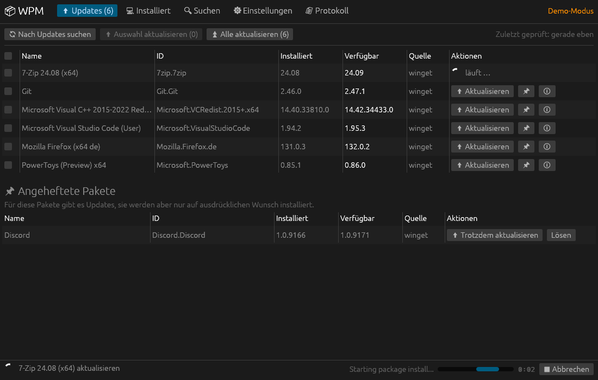

# WPM – grafische Oberfläche für winget

### [⬇ Hier downloaden (wpm.exe)](https://github.com/Stanischewski/WPM/releases/latest/download/wpm.exe)

Der Link lädt immer die neueste Version. Einfach herunterladen und
doppelklicken – eine Installation ist nicht nötig. Läuft unter Windows 10
und 11. Ältere Versionen und Änderungen stehen unter
[Releases](https://github.com/Stanischewski/WPM/releases).

> **„Der Computer wurde durch Windows geschützt“?** Die EXE ist nicht digital
> signiert, deshalb warnt Windows SmartScreen beim ersten Start. Auf
> **„Weitere Informationen“** und dann **„Trotzdem ausführen“** klicken. Auch
> der Browser warnt eventuell, weil die Datei selten heruntergeladen wird –
> dann die Datei in der Download-Liste behalten (in Edge: „…“ →
> „Beibehalten“). Ist unter Windows 11 die **intelligente App-Steuerung**
> (Smart App Control) aktiv, blockiert sie unsignierte Programme ohne
> „Trotzdem ausführen“; dann lässt sich WPM nur starten, wenn man sie unter
> *Windows-Sicherheit → App- & Browsersteuerung* ausschaltet.

Eine einfache, schnelle Oberfläche für den Windows-Paketmanager
[winget](https://learn.microsoft.com/windows/package-manager/winget/),
geschrieben in Rust mit [egui](https://github.com/emilk/egui). Die Idee:
so unkompliziert wie die Paketverwaltung unter Linux – Updates sehen,
mit einem Klick installieren, fertig.



## Funktionen

| Reiter | Was geht |
|---|---|
| **Updates** | Verfügbare Updates anzeigen, einzeln, ausgewählt oder alle installieren. Pakete „anheften“ (Update ignorieren) bzw. wieder lösen. |
| **Installiert** | Alle installierten Programme, filterbar nach Name/ID, mit Details, Aktualisieren und Deinstallieren (mit Rückfrage). |
| **Suchen** | Neue Pakete in winget und/oder Microsoft Store finden und installieren. Bereits installierte Pakete sind markiert. |
| **Einstellungen** | Mit Windows starten (optional unsichtbar im Infobereich), Symbol im Infobereich und Weiterlaufen im Hintergrund (siehe unten), Updates mit Administratorrechten (siehe unten), Updates beim Start und regelmäßig im Hintergrund prüfen, Windows-Benachrichtigung bei neuen Updates, Installationsmodus (still/Standard/interaktiv), Installationsbereich (Benutzer/System), Darstellung (hell/dunkel/wie Windows). Außerdem: winget-Quellen anzeigen und aktualisieren, angeheftete Pakete verwalten, Paketliste exportieren/importieren. |
| **Protokoll** | Jeder ausgeführte winget-Befehl mit seiner vollständigen Ausgabe. |

Aufträge landen in einer Warteschlange und laufen nacheinander (winget mag
keine parallelen Installationen). Die Statusleiste zeigt den Fortschritt live,
laufende Vorgänge lassen sich abbrechen – „Abbrechen“ beendet dabei auch einen
hängenden Installer, den winget gestartet hat (außer Installern, die per
Windows-Bestätigung mit Adminrechten laufen). Kommt von einem Installer drei
Minuten lang keine Rückmeldung, weist die Statusleiste darauf hin: Meist wartet
dann ein eigenes Installer- oder Konsolenfenster auf eine Eingabe.

## Infobereich und Hintergrund

Beides lässt sich unter *Einstellungen → Allgemein* ein- und ausschalten
(Standard: an).

- **Symbol im Infobereich anzeigen** – das WPM-Symbol unten rechts neben der
  Uhr (evtl. hinter „^“). Ein orangefarbener Punkt zeigt verfügbare Updates,
  der Tooltip den aktuellen Stand. Klick öffnet WPM, Rechtsklick zeigt das Menü
  *WPM öffnen*, *Nach Updates suchen* und *Beenden*.
- **Beim Schließen im Hintergrund weiterlaufen** – das Fenster-✕ versteckt WPM
  nur. Die regelmäßige Update-Suche läuft weiter und meldet neue Updates per
  Windows-Benachrichtigung; Installationen laufen zu Ende, danach gibt es eine
  Benachrichtigung mit dem Ergebnis. Beendet wird WPM über *Beenden* im Menü
  des Symbols.
- **Mit Windows starten → Im Hintergrund starten** – mit Symbol im
  Infobereich startet WPM nach der Anmeldung unsichtbar, sonst minimiert in der
  Taskleiste.
- Wird WPM erneut gestartet (Startmenü, Verknüpfung), öffnet sich das Fenster
  der bereits laufenden Instanz.
- Mit Administratorrechten bleibt WPM nicht dauerhaft im Hintergrund: Beim
  Schließen läuft es noch zu Ende, was gerade installiert wird, und übergibt
  dann an eine neu gestartete Instanz **ohne** Adminrechte im Infobereich.

## Starten

Voraussetzung: Windows 10/11 mit installiertem **App-Installer** (enthält
`winget`, ist auf aktuellen Systemen vorinstalliert).

Am einfachsten über „Hier downloaden“ ganz oben. Wer
„Mit Windows starten“ nutzen möchte, legt `wpm.exe` vorher an einen festen
Ort, am besten nach `C:\Program Files\WPM` (siehe
[Weniger Nachfragen beim Aktualisieren](#weniger-nachfragen-beim-aktualisieren)).

Selbst bauen:

```powershell
cargo run --release
```

Zusätzlich baut die GitHub-Action `Build` bei jedem Push eine EXE – unter
*Actions → Build → Artifacts → wpm-windows-x64*.

### Neue Version veröffentlichen

1. Version in `Cargo.toml` erhöhen, einmal `cargo build` ausführen und
   `Cargo.toml` und `Cargo.lock` auf `main` committen. Haben sich
   Abhängigkeiten geändert, vorher die Lizenzhinweise neu erzeugen (siehe
   [Lizenz](#lizenz)) – sonst schlägt die Action fehl.
2. Tag `v<Version>` pushen (z. B. `git tag v0.3.0 && git push origin v0.3.0`)
   – oder unter *Actions → Build → Run workflow* den Branch `main` wählen und
   „Release veröffentlichen“ ankreuzen.

Die Action prüft, testet und baut die EXE und veröffentlicht sie als Release
`v<Version>` (mit SHA-256-Prüfsumme). Der Download-Link oben zeigt danach
automatisch auf die neue Version. Gibt es das Release schon, bricht sie ab,
statt es zu überschreiben.

### Kommandozeilenoptionen

| Option | Wirkung |
|---|---|
| `--demo` | Demo-Modus mit Beispieldaten – kein winget nötig, läuft auch unter Linux/macOS. Gut zum Ausprobieren der Oberfläche. |
| `--minimized` | Minimiert starten. |
| `--autostart` | Wird vom Autostart-Eintrag gesetzt; startet minimiert, wenn das in den Einstellungen so gewählt ist. |
| `--elevated` | Intern: kennzeichnet den mit Adminrechten neu gestarteten Prozess. |
| `--background` | Intern: unsichtbar im Infobereich starten (nach dem Schließen der Instanz mit Adminrechten). |
| `--upgrade=<ID>` | Intern: Update, das nach dem Neustart mit Adminrechten fortgesetzt wird (`*` = alle). |

WPM läuft nur einmal. Ein zweiter Start holt das Fenster der laufenden Instanz
nach vorn (beim Autostart passiert nichts).

## Weniger Nachfragen beim Aktualisieren

Zwei Arten von Fenstern können während Updates aufpoppen:

1. **Installer-Fenster** – im Installationsmodus **„Still“** (Standard,
   `--silent`) zeigen die meisten Installer nichts an. Einzelne Installer
   öffnen trotzdem ein Fenster oder starten das Programm nach dem Update neu.
2. **Windows-Bestätigungen (UAC)** – jeder Installer, der systemweit
   installiert, fragt einzeln nach Adminrechten. Wird eine Nachfrage abgelehnt
   oder übersehen, bricht das Update ab (winget-Code `0x8A15010C`, Installer-
   Exitcode 1602). Manche MSIX-Pakete brauchen zwingend Adminrechte
   (`0x80073D28`).

Gegen Letzteres hilft **„Updates mit Administratorrechten installieren“**
(Einstellungen → Allgemein): Klickt man auf „Aktualisieren“, „Auswahl
aktualisieren“ oder „Alle aktualisieren“, startet WPM sich **einmal** mit
Adminrechten neu (eine Windows-Bestätigung) und setzt genau diese Updates
automatisch fort. Danach fragt kein Installer mehr einzeln, bis WPM geschlossen
wird. Autostart und Update-Suche im Hintergrund laufen weiterhin ganz ohne
Nachfrage. Lehnt man die Bestätigung ab, laufen die Updates wie bisher ohne
Adminrechte. Zusätzlich gibt es in der Statusleiste und bei passenden
Fehlermeldungen „Als Administrator neu starten“ bzw. „Mit Adminrechten erneut
versuchen“.

Bewusst **nicht** umgesetzt: ein Autostart, der WPM ohne Nachfrage mit
Adminrechten startet (z. B. über die Aufgabenplanung). WPM startet winget über
den App-Alias im Benutzerprofil; jedes Programm des Benutzers könnte diesen
austauschen und hätte dann unbemerkt Adminrechte. Adminrechte gibt es deshalb
nur nach einer sichtbaren Windows-Bestätigung – wie bei `winget` in einem
Administrator-Terminal.

Grenzen:

- Nur sinnvoll, wenn das eigene Benutzerkonto ein Administratorkonto ist. Gibt
  man bei der Nachfrage die Zugangsdaten eines *anderen* Kontos ein (oder ist
  der Windows-Administratorschutz aktiv), läuft WPM unter diesem Konto – mit
  dessen Einstellungen und benutzerbezogenen Programmen. WPM erkennt das und
  warnt.
- Manche Installer verweigern Adminrechte (winget-Code `0x8A150056`, z. B.
  Spotify), und benutzerbezogene Programme lassen sich mit Adminrechten nicht
  deinstallieren (`0x8A15007D`). Dafür WPM schließen und normal neu starten.
- Fenster, die keine UAC-Nachfragen sind (Treiber-Vertrauensabfragen,
  Installer, die `--silent` ignorieren, Programme, die nach dem Update neu
  starten), verhindern auch Adminrechte nicht.
- Am besten liegt `wpm.exe` unter `C:\Program Files\WPM`. In beschreibbaren
  Ordnern wie „Downloads“ könnten fremde DLLs neben der EXE mit
  Adminrechten mitgeladen werden (der MSVC-Build aus der GitHub-Action ist
  dagegen gehärtet, siehe `.cargo/config.toml`).

**Fehlermeldungen** zeigen eine Kurzfassung und, wo bekannt, eine Erklärung
mit Abhilfe – z. B. bei Installer-Exitcode **1603** (allgemeiner Fehler, meist
läuft das Programm noch), 1618, 1638 oder 740, oder bei **„kein passendes
Update“** (`0x8A15002B`: die neue Version passt nicht zur Installationsart;
neu installieren oder anheften). Nennt winget ein Installationsprotokoll, gibt
es den Knopf „Protokoll öffnen“, bei nicht passenden Updates „Anheften“. Die
vollständige Ausgabe von winget steht unter „Details“.

**Update hängt?** Manche Installer öffnen trotz „Still“ ein eigenes Fenster
und warten dort – z. B. `rustup-init` (Paket `Rustlang.Rustup`), wenn noch
Rust-Programme wie `cargo` oder `rust-analyzer` laufen und Dateien gesperrt
sind. Dann das Fenster in der Taskleiste suchen, die Programme schließen oder in
WPM „Abbrechen“. Programme, die sich selbst aktualisieren (wie Rustup über
`rustup self update`), heftet man am besten an.

**Update installiert, aber weiter in der Liste?** Bei MSIX-Paketen (z. B.
Claude) meldet winget Erfolg, aktiviert die neue Version aber erst, wenn die
Anwendung beendet ist. WPM erkennt das und weist darauf hin. Bleibt das Update
auch danach stehen, erkennt winget die Version falsch – dann das Paket
anheften, vor allem wenn es sich ohnehin selbst aktualisiert.

### Cross-Compile unter Linux

```sh
rustup target add x86_64-pc-windows-gnu
sudo apt install gcc-mingw-w64-x86-64
CARGO_TARGET_X86_64_PC_WINDOWS_GNU_LINKER=x86_64-w64-mingw32-gcc \
  cargo build --release --target x86_64-pc-windows-gnu
```

## Was man mit winget alles abfragen kann

WPM nutzt diese Befehle (alle mit `--accept-source-agreements` und
`--disable-interactivity`, damit winget ohne Konsole nie auf eine Eingabe wartet):

| winget-Befehl | Verwendung in WPM |
|---|---|
| `winget upgrade` | verfügbare Updates (inkl. angehefteter Pakete) |
| `winget list` | installierte Programme |
| `winget search --query …` | Pakete suchen |
| `winget show --id …` | Paketdetails (Beschreibung, Herausgeber, Lizenz, Homepage …) |
| `winget install` / `upgrade` / `uninstall --id … --exact` | Pakete verwalten |
| `winget pin add/remove/list` | Updates für einzelne Pakete ignorieren |
| `winget source list/update` | Paketquellen anzeigen und aktualisieren |
| `winget export` / `import` | Paketliste sichern bzw. auf einem neuen PC wiederherstellen |
| `winget --version` | Version anzeigen / prüfen, ob winget vorhanden ist |

Weitere Möglichkeiten, die sich später ergänzen ließen:

- `winget download` – Installer nur herunterladen
- `winget repair` – beschädigte Installation reparieren
- `winget configure` – ganze Rechner-Konfigurationen (DSC) anwenden
- `winget settings` – winget-eigene Einstellungen (z. B. Download-Verhalten)
- `winget source add` – eigene/firmeninterne Paketquellen

## Aufbau

```
src/
├── main.rs            Startparameter, Fenster
├── app/               Oberfläche (ein Modul je Reiter)
├── winget/
│   ├── mod.rs         Befehle bauen, Ergebnisse auswerten, Fehlercodes
│   ├── parse.rs       Parser für die Tabellen-Ausgabe von winget
│   └── demo.rs        simuliertes winget für --demo und Tests
├── runner.rs          winget als Prozess starten, Ausgabe live lesen
├── worker.rs          Warteschlange im Hintergrund-Thread
├── scheduler.rs       regelmäßige Update-Prüfung
├── settings.rs        Einstellungen (%APPDATA%\WPM\settings.json)
├── tray.rs            Symbol im Infobereich
└── system.rs          Autostart, Adminrechte, Einzelinstanz, Benachrichtigungen
```

Autostart schreibt den Eintrag `WPM` unter
`HKCU\Software\Microsoft\Windows\CurrentVersion\Run` (keine Adminrechte nötig,
keine Nachfrage beim Anmelden).

## Gut zu wissen

- **winget hat keine maschinenlesbare Ausgabe.** WPM liest die Textausgabe:
  Spalten werden über die Position der Kopfzeile erkannt, nicht über die
  (übersetzten) Spaltennamen. Das funktioniert unabhängig von der
  Windows-Sprache, ist aber naturgemäß empfindlicher als eine echte API.
- **Gekürzte IDs:** Ohne Konsole kürzt winget breite Tabellen auf 120 Zeichen
  und hängt „…“ an. Für solche IDs sucht WPM ohne `--exact` nach dem Anfang
  der ID; ist das nicht eindeutig, meldet winget das.
- **Adminrechte:** WPM selbst braucht keine. Gegen einzelne UAC-Nachfragen
  der Installer hilft „Updates mit Administratorrechten installieren“ (siehe
  oben).
- **Sicherheit:** `winget.exe` wird über seinen vollen Pfad gestartet (App-Alias
  bzw. `PATH` ohne Programmordner und aktuelles Verzeichnis), damit nie eine
  gleichnamige Datei aus dem Programmordner (z. B. dem Download-Ordner) mit
  Adminrechten läuft. Nachgeladene DLLs kommen nur aus `System32`.
- **Hintergrundprüfung** läuft, solange WPM läuft – auch minimiert oder
  versteckt im Infobereich.

## Mögliche nächste Schritte

- statt Text-Parsing die WinGet-COM-API (`Microsoft.Management.Deployment`)
  oder das PowerShell-Modul `Microsoft.WinGet.Client` nutzen
- weitere Paketmanager wie Scoop oder Chocolatey
- Programmsymbol in der EXE (Ressourcendatei)

## Lizenz

[MIT](LICENSE) – darf frei genutzt, verändert und weitergegeben werden, auch
kommerziell, solange der Lizenzhinweis erhalten bleibt; ohne Gewähr.

WPM enthält Open-Source-Bibliotheken anderer Autorinnen und Autoren (egui,
winit, windows-rs, die Schriftarten von egui u. a.). Ihre Lizenzhinweise stehen
in [THIRD-PARTY-LICENSES.txt](THIRD-PARTY-LICENSES.txt), liegen jedem Release
bei und sind in die EXE eingebettet: *Einstellungen → Über → Lizenzen
anzeigen*. So sind sie auch dabei, wenn nur `wpm.exe` weitergegeben wird.

Die Datei wird mit [cargo-about](https://github.com/EmbarkStudios/cargo-about)
erzeugt – nur aus den Abhängigkeiten, die tatsächlich in der Windows-EXE
landen. Nach Änderungen an den Abhängigkeiten neu erzeugen:

```sh
cargo install cargo-about --locked --features cli --version 0.9.2
cargo about generate --locked --fail -o THIRD-PARTY-LICENSES.txt about.hbs
```

`about.toml` legt die akzeptierten Lizenzen fest und ergänzt Lizenzdateien, die
cargo-about nicht selbst findet (abgesichert über Prüfsummen). Die Action
prüft bei jedem Push, ob die Datei noch aktuell ist.
